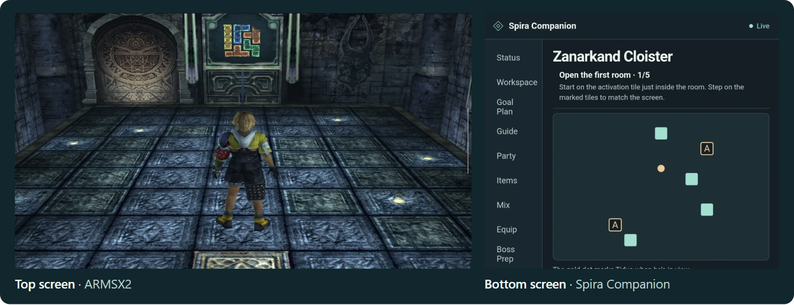

<h1 align="center"> Spira Companion</h1>

A live second screen for <strong>Final Fantasy X International</strong> and <strong>Final Fantasy X-2 USA</strong> on the AYN Thor. Connects through ARMSX2 with PINE enabled.

<strong><a href="app/">Browse source code</a></strong> &nbsp;·&nbsp; <strong><a href="https://github.com/BaileyPillon/spira-companion-releases/releases/latest/download/SpiraCompanion-source.zip">Download source ZIP</a></strong> &nbsp;·&nbsp; <a href="https://github.com/BaileyPillon/spira-companion-releases/releases/latest/download/SpiraCompanion.apk">Install the Android APK</a>

<a href="app/src/Ps2Feed.java">Emulator reader (Java)</a> &nbsp;·&nbsp; <a href="app/assets/spira.js">Companion interface (JavaScript)</a> &nbsp;·&nbsp; <a href="docs/build.md">Build instructions</a> &nbsp;·&nbsp; <a href="docs/player-guide.md">Player guide</a>

<picture>
  <source media="(max-width: 640px)" srcset="docs/images/zanarkand-mobile.webp">
  
</picture>

*Zanarkand Cloister, captured on the Thor. The gold dot follows Tidus as you move.* [Game screen](docs/images/zanarkand-top.webp) · [Companion screen](docs/images/zanarkand-guide.webp)

**New in 1.44.** See which Monster Arena region you can finish next, try a Blitzball substitute, or compare dressphere mastery across Yuna, Rikku and Paine. Leave yourself a checkpoint for next time. Use **Page index** to jump to a section and **Back** to return to your hunt or guide. [Screenshots, ranked requests and changes by section](docs/research-1.44.md)

**Also on the lower screen.** Tap a Sphere Grid node to compare its original contents with your save. Follow a Rikku Mix from effect to ingredient and back. In FFX-2, rehearse a Garment Grid change or find unrecorded scenes by destination. [See these four tools](docs/research-1.43.md)

The menus follow the game’s palette. **Glance** shows the party or current encounter, and **Display** controls reading size and OLED black. [Glance and display controls](docs/research-1.42.md)

## Set up your Thor

Start with your own supported PS2 game in **ARMSX2** and its game entry in **Cocoon**. [Check your disc version](#supported-ps2-versions)

1. **Install Spira.** Open the [APK](https://github.com/BaileyPillon/spira-companion-releases/releases/latest/download/SpiraCompanion.apk) on your Thor.
2. **Connect the emulator.** In ARMSX2 settings, turn on **Enable PINE** and leave the port at **28011**.
3. **Pair the screens.** In Cocoon, edit the game entry, choose **Spira Companion** under **Companion App**, and save with the check mark. Launch the game from Cocoon and load a save.

Open **Status** on the bottom screen. **Live** means Spira is reading the game. It works locally, including after you unplug the Thor. [Help with connection messages](docs/player-guide.md#connection-help)

## Final Fantasy X

- **Prepare for a boss with the gear you own.** Boss Prep compares your party’s equipment and lists materials for upgrades. In battle, Status shows the next 16 turns, your target’s HP and the Overkill threshold.
- **Pick up where you left off.** The map follows your position. Cloister guides use the current puzzle state in all six temples. If you own the compatible offline Jegged export, the full-screen reader can follow your walkthrough too.
- **Track a longer run.** Pin a missing Monster Arena capture, find its hunting area, plan a Sphere Grid route or see when a Blitzball contract expires.

[FFX tools and walkthrough setup →](docs/player-guide.md#final-fantasy-x)

## Final Fantasy X-2

The **Chapter Checklist** can take you from a missing scene to the place you need to visit. In the Chapter 5 save below, Spira found an unrecorded Crimson Record scene and pointed to Shinra’s station on the Celsius. Branch-specific scenes are marked in the checklist.

View the Chapter 5 checklist on the Thor

*Bikanel Oasis is where the first recording takes place. To watch it, open Treasure Spheres at Shinra’s station aboard the Celsius.*

- **Plan jobs and spherechanges.** Track dressphere pickup deadlines and ability AP, then find a route through the colored gates on a Garment Grid.
- **Read a fight.** Follow party and enemy HP/MP, selected targets, current dresspheres and active effects.
- **Finish the fiend list.** Check Oversouls by Via Infinito floor and see which Blue Bullets each character still needs.

[FFX-2 tools and chapter guidance →](docs/player-guide.md#final-fantasy-x-2)

## Supported PS2 versions

| Game | Disc serial | CRC | Support |
| --- | --- | --- | --- |
| FFX International | `SLPS-25088` | `658597E2` | Primary |
| FFX-2 USA | `SLUS-20672` | `48FE0C71` | Primary |
| FFX-2 International | `SLPM-65478` | `E1FD9A2D` | Limited support, checked with an opening save |

Spira matches both values. Patched discs can report a different CRC. Tracking is read-only by default. [Optional settings](docs/player-guide.md#connection-help)

## Source code

The [Android app](app/src/) reads the emulator through PINE. The [companion interface](app/assets/) turns each live frame into maps, battle tools and checklists for the bottom screen. The [optional Windows bridge](bridge/) reads the Steam HD Remaster.

[Build and test Spira](docs/build.md) · [Browse regression tests](tests/) · [Data generators and test tools](tools/)

Spira’s original code is available under the [MIT License](LICENSE). The bundled reference data and third-party components retain their [upstream notices](docs/player-guide.md#credits). Final Fantasy names and artwork belong to their respective owners.

## Feedback

[Report a gameplay or setup problem](https://github.com/BaileyPillon/spira-companion-releases/issues/new?template=gameplay-report.yml) · [Request a feature](https://github.com/BaileyPillon/spira-companion-releases/issues/new?template=feature-request.yml)

Spira is an unofficial fan project inspired by the [FFXII Thor Companion](https://github.com/Cybranfox/ffxii-thor-companion). Third-party license notices are included in the APK. [Credits](docs/player-guide.md#credits)
