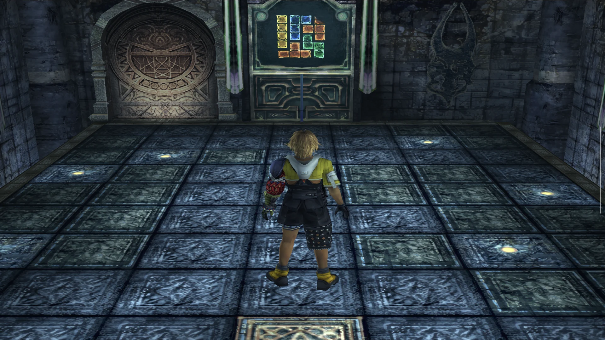
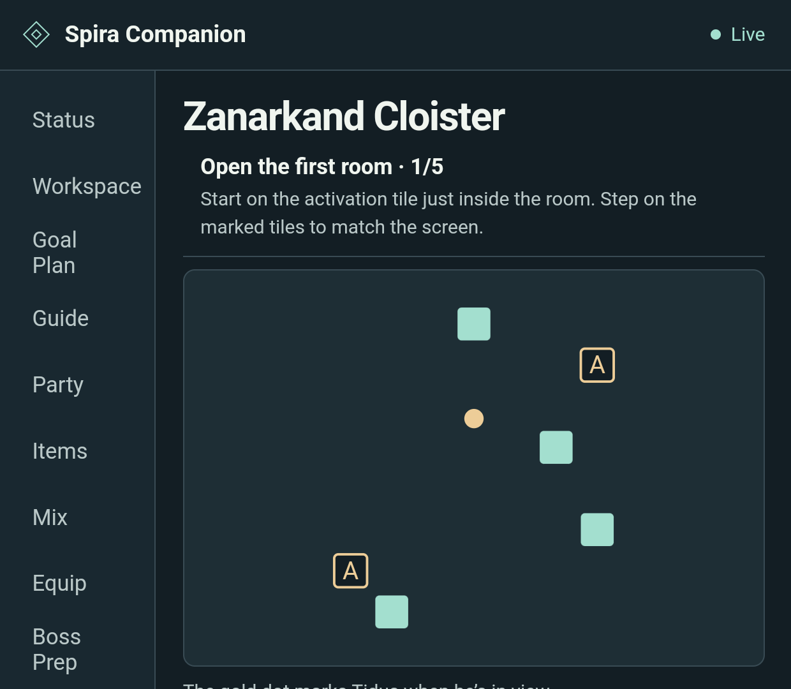

# Spira Companion

A live second-screen guide for **Final Fantasy X** and **Final Fantasy X-2** on the **AYN Thor**. Play on the top screen while the bottom screen follows your position, shows what a boss is doing, or helps you find the last thing missing from your save.

**[Download the Android APK](https://github.com/BaileyPillon/spira-companion-releases/releases/latest/download/SpiraCompanion.apk)** · [Set up your Thor](#set-up-your-thor) · [Player guide](docs/player-guide.md) · [Release notes](https://github.com/BaileyPillon/spira-companion-releases/releases/latest)

For the PS2 editions of **FFX International** and **FFX-2 USA**, running in ARMSX2 with PINE enabled. [Check your disc](#supported-ps2-versions)

  
  

*One moment on the Thor’s two displays. As Tidus moves in Zanarkand, the gold dot follows him on the puzzle diagram.*

## Set up your Thor

1. Install **SpiraCompanion.apk** on the Thor.
2. In **ARMSX2 → Settings**, turn on **Enable PINE** and leave the port at **28011**. This lets the companion read the game on the handheld.
3. In **Cocoon**, edit the game entry, set **Companion App** to **Spira Companion**, and save with the check mark. Repeat for your other game if needed.
4. Launch the game from Cocoon and load a save. The companion’s **Status** view should say **Live** and show your party or current area.

Spira runs locally after setup, including when the Thor is unplugged. Live tracking is read-only by default. [Connection help and optional settings](docs/player-guide.md#connection-help)

## What to open first

| In Final Fantasy X International | In Final Fantasy X-2 USA |
| --- | --- |
| **Cloister guide** follows the state of all six temple puzzles. If you already have the supported Jegged export, **Guide** can also follow the walkthrough full screen. | **Chapter Checklist** shows which scenes your save has recorded, where to trigger the others, and which depend on your route. |
| **Boss Prep** compares gear you already own. **Status** shows the next 16 turns, your target’s HP and its Overkill threshold. | **Status** follows enemy and party HP, targets, effects and current dresspheres. **Equip** helps plan spherechanges through Garment Grid gates. |
| **Arena** finds your missing captures. **Blitzball** tracks contracts and Wakka’s prizes. **Sphere Grid** plans a route for each character. | **Fiend Guide** tracks Oversouls and Blue Bullets. **Challenges** covers Sphere Break, the Chocobo Ranch, tower calibration and more. |

[Explore the tools for both games](docs/player-guide.md)

## Supported PS2 versions

Match both the serial and CRC shown for your game. A patch can change the CRC.

| Game | Disc serial | CRC | Coverage |
| --- | --- | --- | --- |
| Final Fantasy X International | `SLPS-25088` | `658597E2` | Main FFX companion |
| Final Fantasy X-2 USA | `SLUS-20672` | `48FE0C71` | Main FFX-2 companion |
| Final Fantasy X-2 International | `SLPM-65478` | `E1FD9A2D` | Limited reader, checked at the opening save |

## Feedback and credits

[Report a problem](https://github.com/BaileyPillon/spira-companion-releases/issues/new?template=gameplay-report.yml) · [Suggest a feature](https://github.com/BaileyPillon/spira-companion-releases/issues/new?template=feature-request.yml)

Spira is an unofficial fan project inspired by the [FFXII Thor Companion](https://github.com/Cybranfox/ffxii-thor-companion). Bring your own games and optional offline walkthrough. Reference data credits and license notices are included in the APK. [Project credits](docs/player-guide.md#credits)
