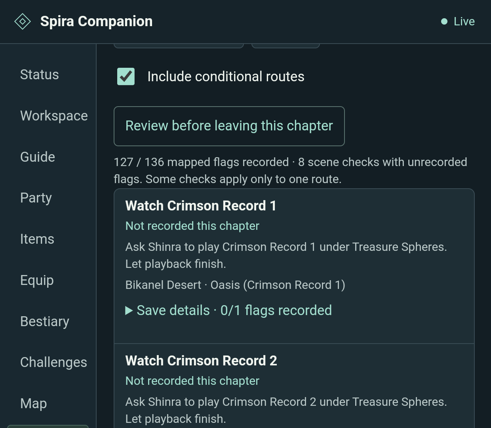

# Spira Companion player guide

[Download and setup](../README.md#set-up-your-thor) · [Final Fantasy X](#final-fantasy-x) · [Final Fantasy X-2](#final-fantasy-x-2) · [Connection help](#connection-help)

## Final Fantasy X

**Keep the walkthrough on the bottom screen.** This optional reader checks the exact file checksum of one offline Jegged export. You supply the file separately. The map, battle tools and Cloister guides work with the game alone.

If you have the matching `FFX - Complete Offline Walkthrough.html`, open **Guide → Choose walkthrough**, select it and tap **Full screen**. The page follows you between mapped areas and holds your place during ordinary battles. **Pause follow** lets you read ahead. **Back to game** returns to the current section.

How to identify the supported walkthrough file

The original HTML export is 40,660,758 bytes. Its SHA-256 checksum is `5cf7b64256cc5e53453e1358a16acc7f51b72679e48856569724e4f72a853784`.

**See what matters in the moment.** The full-screen guide can point out a nearby missable, a recruit or a Mix you can make. Open a suggestion, then tap **Back to full-screen guide**. If you prefer automatic switching, turn on **Follow Game automatically** under **Status → Live coach**. Spira can open a battle or Blitzball view and restore the previous screen afterward.

| During your run | Where to look |
| --- | --- |
| A boss is giving you trouble | **Boss Prep** checks your party’s gear and customization materials for Evrae, the Dark Aeons, Penance or Don Tonberry. **Status** shows turn order, targets, effects, Overkill thresholds and AP participation. **Mix** filters recipes by the items in your bag. |
| You’re in a Cloister | Open **Cloister guide** from the in-temple tip or **Workspace**. Each of the six temples has instructions tied to its puzzle state. The Anima treasure checklist records which temple chests you have opened. |
| You’re hunting a fiend or farming materials | **Arena** covers all 102 capturable species. Pin a missing capture, find an encounter area and watch for it in battle. Use **Bestiary** for drops, steals, bribes and equipment odds. |
| You’re working on a character or endgame goal | **Sphere Grid** shows remaining nodes and route costs on Standard and Expert layouts. Try stat replacements in the sandbox and export a build. **Goal Plan** combines captures, gear and shared materials. **Collections** tracks Primers, Jecht Spheres, Celestials, optional Aeons and boss clears. |
| You’re playing Blitzball or chasing a sigil | **Blitzball** covers rosters, contracts, Techcopy, Wakka’s prizes and live matches. **Challenges** tracks Catcher Chocobo, Butterfly Catcher, lightning records and the current Cactuar clue. Start a fresh lightning streak at zero to use the estimate. |

## Final Fantasy X-2

**Find a scene you missed.** Open **Chapter Checklist**, choose a chapter and expand a scene. The guide groups 525 mapped flags into scene checks with locations and trigger instructions. Some depend on earlier choices. Use **Save details** to see what the game recorded. The example below shows a Chapter 5 save and the instructions for watching a Crimson Record at Shinra’s station.

| During your run | Where to look |
| --- | --- |
| You’re building a party | **Dressphere Hunt** covers all 17 dresspheres and pickup deadlines. Check ability AP for the 14 standard jobs. **Equip** compares accessories and maps paths to bonuses or special dresspheres across all 60 obtainable Garment Grids. |
| You’re in battle | **Status** shows party and enemy HP/MP, current dresspheres, targets and supported status effects. Recovery tips use items available in your inventory. |
| You’re filling out Shinra’s list | **Fiend Guide** covers 131 Oversouls. It reads 95 entries automatically and offers manual checks for the rest. Search by Via Infinito floor or see which of the 16 Blue Bullets each character still needs. |
| You’re cleaning up a chapter | Check CommSphere events, Crimson Spheres and Den of Woe progress. **Challenges** covers Sphere Break boards, Publicity and Matrimony, Chocobo Ranch dispatches, Tower Calibration and the Experiment. |

## Connection help

| What you see | What to check |
| --- | --- |
| **Waiting** | Start the game in ARMSX2. Check **Enable PINE** and port **28011**. Both apps run on the same Thor. |
| **At title screen** | The emulator is connected. Load a save or start a game to populate the companion. |
| **Unsupported disc** | Compare both values shown on screen with the [serial and CRC table](../README.md#supported-ps2-versions). |
| **Sample data** | Select **End preview**, launch the supported game and open **Status** to check the live session. |
| The walkthrough stays on the same page | Check that FFX International is running, a supported walkthrough is selected and follow is active. Tap **Back to game**. The reader keeps its place in unknown rooms. |

**Optional settings.** Use **Workspace** to search, pin tools, keep notes or back up companion profiles. Full-screen guide suggestions can be turned off under **Setup**. Cheats are hidden by default. Enabling them exposes one-time changes to gil and owned recovery items, plus optional session-only AP sharing in FFX.

## Credits

Bundled notices accompany the reference data from [FFX RNG Tracker](../app/assets/LICENSE-FFX-RNG-tracker.txt), [FFX Sphere Grid Viewer](../app/assets/LICENSE-FFX-Sphere-Grid-viewer.txt) and [noclip.website](../app/assets/LICENSE-noclip.txt).

The second-screen workflow was inspired by [Cybranfox’s FFXII Thor Companion](https://github.com/Cybranfox/ffxii-thor-companion). FFX reference data draws on [FFX RNG Tracker](https://github.com/Grayfox96/FFX-RNG-tracker), [FFX Sphere Grid Viewer](https://github.com/Grayfox96/FFX-Sphere-Grid-viewer) and [noclip.website](https://github.com/magcius/noclip.website). FFX-2 scene guidance draws on [retail PS2 flag research](https://github.com/Sonicshadowsilver2/Final-Fantasy-X-2-Coding/wiki/Percentage-Flags). The optional offline walkthrough is by [Jegged](https://jegged.com/Games/Final-Fantasy-X/).
