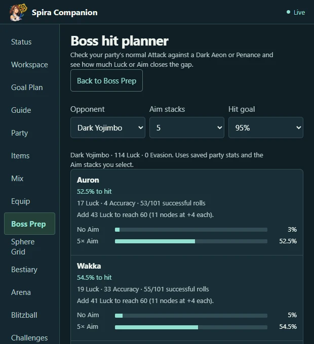

# Four player requests behind Spira 1.40

The ranking weighs independent reports of the same problem, the cost of a wrong decision in a playthrough, and what the PS2 companion can show while you play. The linked sample contains twelve Reddit discussions across four questions. Scores, comments and search positions were not counted as votes. English-language search and publicly indexed GitHub repositories leave gaps, so the ordering is an editorial judgment.

## Ranked findings and implementation

| Rank | Player question | Where to use it |
| --- | --- | --- |
| 1 | **How much Luck does my party need for this boss?** Advice for Penance’s body, its arms, Dark Yojimbo and Dark Mindy often gets mixed together. A wrong target costs hours of Sphere Grid farming. [Dark Aeon thresholds](https://www.reddit.com/r/finalfantasyx/comments/1wek64l/) · [Dark Yojimbo](https://www.reddit.com/r/finalfantasyx/comments/1h12kic/) · [Luck maxing](https://www.reddit.com/r/finalfantasyx/comments/1lactb6/) · [Stopping the stat grind](https://www.reddit.com/r/finalfantasyx/comments/1esfwaw/) | **FFX → Boss Prep → Boss hit planner.** Select any of 13 targets, choose a 90%, 95% or 100% hit goal and adjust Aim. Each character gets a normal Attack forecast from their saved Luck and Accuracy, a comparison at zero and five Aim stacks, and the additional Luck and +4 nodes needed. Follow fight tracks the first living supported opponent. |
| 2 | **Which region cost me Mascot?** Players report seeing an ending everywhere and missing the dressphere. One returned to a save and found the Calm Lands publicity campaign unfinished. Another asked if a missed region could be carried into the next run. [Missing Mascot after Chapter 5](https://www.reddit.com/r/finalfantasyx/comments/11fi80t/) · [Starting a new run for one episode](https://www.reddit.com/r/finalfantasyx/comments/1jq9q1v/) | **FFX-2 → Chapter Checklist → Mascot episode board.** All 15 regional endings have a route and related scenes from the loaded save. Mark the result displayed on the Celsius map and filter to unresolved or Concluded regions. Calm Lands shows both companies’ actual points. Inventory ownership, the award scene and your current-run confirmations are shown separately. |
| 3 | **Why is my Celestial weapon hitting for less?** Players compare similarly customized weapons, spend time acquiring a Celestial, then get an unexpected result. Auron, Tidus and Yuna can give three different answers at the same HP. [Celestial vs. customized](https://www.reddit.com/r/finalfantasyx/comments/1dedhn1/) · [Auron dealing less damage](https://www.reddit.com/r/finalfantasyx/comments/w9u95y/) · [The endgame grind](https://www.reddit.com/r/finalfantasyx/comments/1jf74a2/) · [Yuna at low HP](https://www.reddit.com/r/finalfantasyx/comments/1fic1bm/) | **FFX → Equip → Celestial weapon power.** All seven characters get a current multiplier, gear status and HP/MP comparison. In **Battle comparison**, supported physical weapon strikes use the multiplier and bypass Defense. Armored, Protect and the damage cap still apply. |
| 4 | **Which Besaid digit goes in which door?** Players have entered the correct-looking numbers at the wrong panel or mistaken a 7 for an 8. The reports are fewer, but the failure and its solution are specific. [Search Sphere digit misread](https://www.reddit.com/r/finalfantasyx/comments/1q28sx0/) · [Which four-digit code?](https://www.reddit.com/r/finalfantasyx/comments/upj99j/) | **FFX-2 → Challenges → Besaid cipher notebook.** Each door has its own four slots in keypad order. The player enters the observed digits, including zero, and can flag any for another look. On Besaid the live room highlights nearby clues. Returning to the notebook restores both codes in the active profile. |

## Repositories and game evidence

*The party comes from a recorded Bevelle Highbridge save. Dark Yojimbo is the planning target.*

- **FFX battle math.** The normal Attack comparison and planner share the hit table, Luck, Evasion and strict hit-roll comparison. For example, a score of 100 wins 100 of the model’s 101 possible roll values. The PS2 mechanics guide documents the distinct Celestial multipliers. The lookup tool and speedrun tracker already provide reference and encounter workflows, which helped narrow this release to party-specific forecasts. [RNG Tracker hit model](https://github.com/Grayfox96/FFX-RNG-tracker/blob/main/ffx_rng_tracker/events/character_action.py) · [PS2 enemy and damage mechanics](https://gamefaqs.gamespot.com/ps2/197344-final-fantasy-x/faqs/24166) · [FFX Lookup Tool](https://github.com/andreasSchauer/ffx-lookup-tool) · [FFXTracker](https://github.com/shenef/FFXTracker)
- **FFX-2 records and regional outcomes.** The PS2 research wiki documents USA room numbers and dialogue flags. Split Infinity’s PS2 route identifies the regional outcomes and the order of the outer Besaid digits. The independent cipher guide covers the four Search Sphere camera positions. These sources support matching a scene and a location. A character’s dialogue can carry through New Game Plus, so only the player’s map confirmation increments the 15-region count. [PS2 percentage flags](https://github.com/Sonicshadowsilver2/Final-Fantasy-X-2-Coding/wiki/Percentage-Flags) · [PS2 room list](https://github.com/Sonicshadowsilver2/Final-Fantasy-X-2-Coding/wiki/Room-Modifier) · [Mascot speed guide](https://gamefaqs.gamespot.com/ps2/562386-final-fantasy-x-2/faqs/28836) · [PS2 Besaid walkthrough](https://gamefaqs.gamespot.com/ps2/562386-final-fantasy-x-2/faqs/25872) · [Search Sphere guide](https://jegged.com/Games/Final-Fantasy-X-2/Side-Quests/Search-Sphere-and-the-Besaid-Key.html)
- **Other companions and editions.** The FFXII project provides the dual-screen comparison. The FFX-2 trophy and Oversoul projects show how other tools organize completion tasks. Farplane and the save editor document remaster-specific data. Spira 1.39.1 already covered capture circuits, AP farming setup, Bribe shopping, dialogue comparisons, Oversouls and a Sphere Break solver. This release builds on the PS2 readers already shipped in Spira. [FFXII Thor Companion](https://github.com/Cybranfox/ffxii-thor-companion) · [FFX-2 trophy tracker](https://github.com/gsouza994/ffx2-trophy-tracker) · [Oversoul checklist](https://github.com/CaptainChrispy/ffx2-oversoul-checklist) · [Farplane](https://github.com/topher-au/Farplane) · [FFX2SaveEditor](https://github.com/Meth962/FFX2SaveEditor) · [Previous Spira research](research-1.39.md)
