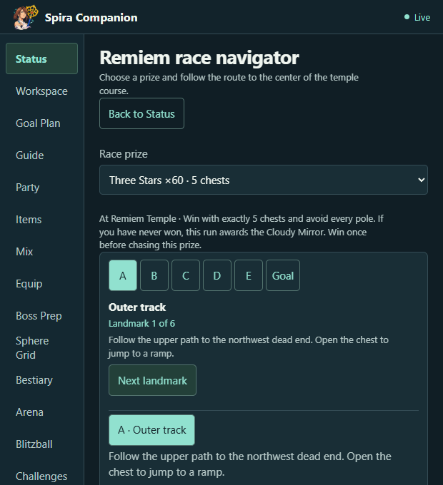

# The three player problems behind Spira 1.41

I ranked these by how often the same question appeared in independent player discussions, what a mistake costs in-game, and whether having the answer on the lower screen changes your next move. This is an editorial ranking of gaps in 1.40. Reddit votes, GitHub stars and YouTube views measure different things and were not combined into a popularity score.

## 1. Surviving a story boss with the party you actually brought

Yunalesca and Seymour Flux come up together in hardest-boss discussions. They teach almost opposite lessons. A player who learned to cure Zombie immediately against Seymour can lose the whole front line doing that against Yunalesca. Several players describe wiping even after reading a guide or grinding. [Boss comparison](https://www.reddit.com/r/finalfantasyx/comments/1vd89zq/) · [Yunalesca after grinding](https://www.reddit.com/r/finalfantasyx/comments/1n8ssqx/) · [Mega Death](https://www.reddit.com/r/finalfantasyx/comments/1dds6t3/) · [Seymour Flux without grinding](https://www.reddit.com/r/finalfantasyx/comments/1pro7vr/)

**Shipped in Boss Prep → Story boss coach.** During a supported fight, Spira names the affected allies and checks active status, worn Deathproof armor and recovery items. Yunalesca’s individual HP pools can identify a form. With an unfamiliar HP pool, choose the form on screen. Against Flux, the coach flags Zombie, Reflect and missing Shell. The game’s charge message and turn queue tell you when to act. Both fights can be studied before reaching them. [Yunalesca fight mechanics](https://gamefaqs.gamespot.com/ps2/197344-final-fantasy-x/faqs/79145/zanarkand) · [Flux encounter and charge sequence](https://jegged.com/Games/Final-Fantasy-X/Walkthrough/26-Mt-Gagazet.html) · [Square Enix status table](https://cdn.sqexeu.com/sea/ffxii/manuals/FFX-FFX2_PS3_ManInt_English_013014.pdf) · [Creator’s Yunalesca walkthrough notes](https://www.youtube.com/watch?v=JQ3sf0QcvSU)

## 2. Knowing which Remiem race to run

One player wanted four chests for Pendulums. Another was trying repeatedly for five. Others simply wanted to know whether they had to race for the mirror. A five-chest walkthrough gives three different players the same answer. [Four-chest prize discussion](https://www.reddit.com/r/finalfantasyx/comments/1mqa1ta/) · [Five-chest attempts](https://www.reddit.com/r/finalfantasyx/comments/1bjvb41/) · [Mirror question](https://www.reddit.com/r/finalfantasyx/comments/1uunusr/)

**Shipped in Challenges → Remiem race navigator.** Choose a prize to get just the relevant landmarks. The first win gives the Cloudy Mirror. Subsequent prize runs require an exact chest count, zero pole contacts and a win. A one-tap landmark strip, saved place and manual prize marks work throughout all six routes. The room shortcut appears at Remiem Temple. [PS2-era route discussion](https://forums.neoseeker.com/569/t941806-remiem-temple/) · [Course diagram and rewards](https://eip.gg/ffx-x2/guides/remiem-temple/) · [Video guide covering five through one chest](https://www.youtube.com/watch?v=oOUR_HQIZq0)

*Five-chest route on a 620-pixel test display. The location was set to Remiem for this example.*

## 3. Solving the Thunder Plains cave without a separate spreadsheet

Players describe arriving with what looks like the right code and discovering that a clue refers to a different wall, a previous screen or a particular stretch of battles. A list of another player’s sixteen answers cannot solve a different visit. [Wall 6 calculation](https://www.reddit.com/r/finalfantasyx/comments/1auem7b/) · [Wall code rejected](https://www.reddit.com/r/finalfantasyx/comments/128tifu/) · [Cave help](https://www.reddit.com/r/finalfantasyx/comments/1go5tij/)

**Shipped in FFX-2 Challenges → Thunder Plains wall solver.** Copy each clue from the upper screen. Carry the lower-right clue forward, insert earlier wall codes and calculate battles or gil earned between two checkpoints. A blank stays unknown. Record a zero when the game gives you zero. Confirm a code after the game accepts it. A chest-opened wall can be entered directly. The two clears have independent notebooks and the companion remembers your place. [Kouli’s worked PS2 run](https://gamefaqs.gamespot.com/ps2/562386-final-fantasy-x-2/faqs/26615) · [Wall order and rewards](https://jegged.com/Games/Final-Fantasy-X-2/Side-Quests/New-Cave.html) · [Creator’s door-by-door video notes](https://www.youtube.com/watch?v=df7zxe2-Gdg)

## What the repositories contributed

- The original Thor companion established the dual-screen use case. Spira’s own 1.40 code already included endgame hit odds, Celestial power, Mascot and the Besaid code notebook. These additions address different moments of play. [FFXII Thor companion](https://github.com/Cybranfox/ffxii-thor-companion) · [Spira 1.40 source](https://github.com/BaileyPillon/spira-companion-releases/tree/v1.40.0/app)
- The FFX TAS project separates race routes by goal and records ramp and pole landmarks. The RNG tracker models battle mechanics. Those distinctions informed the route and combat views. Spira uses its existing PS2 battle feed and original route descriptions. [TAS race paths](https://github.com/coderwilson/FFX_TAS_Python/blob/f31d237/paths/nem/races.py) · [FFX RNG Tracker](https://github.com/Grayfox96/FFX-RNG-tracker)
- The FFX-2 coding wiki identifies the USA New Cave room as 0x0F9. The save editor catalogs endgame items and the trophy tracker organizes completion goals. None supplied a verified live pair of puzzle clues for Spira’s supported disc, so the calculator uses the clues the player sees. [PS2 room list](https://github.com/Sonicshadowsilver2/Final-Fantasy-X-2-Coding/wiki/Room-Modifier) · [FFX2SaveEditor](https://github.com/Meth962/FFX2SaveEditor) · [FFX-2 trophy tracker](https://github.com/gsouza994/ffx2-trophy-tracker)

The sample covers publicly accessible, indexed discussions and repositories. YouTube evidence came from titles and creator descriptions. The racing routes and puzzle rules were cross-checked against written PS2 sources. [Build verification](../THOR-VALIDATION.md)
