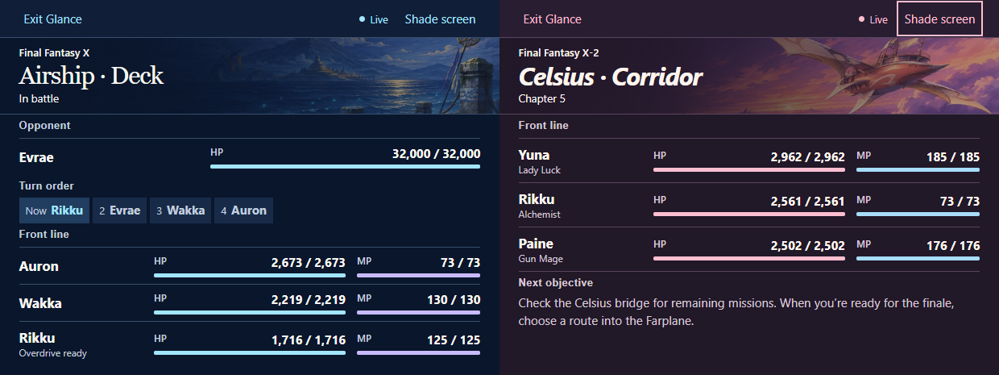

# Designing Spira for the lower screen

Version 1.41 had 23 navigation buttons in the source. Which ones appeared depended on the game and available data. Its menus shared one teal palette and many labels were fixed at 11–15 CSS pixels. On the Thor, moving from a busy battle to a long guide meant using the same hierarchy and type scale for two different jobs.

*Companion UI at 620 × 465 in each pane, replaying the Evrae opening and a Celsius corridor save.*

## Ranked changes

| Rank | What players said | What shipped |
| --- | --- | --- |
| **1. Make the two screens feel like the same game.** | A player specifically asked the FFXII Thor project to bring its window styles, spacing and cursor closer to the game. Elsewhere, Thor owners show coordinated upper and lower screens, while others object to a forced light or gray theme. [FFXII design request](https://www.reddit.com/r/AynThor/comments/1xez6zt/) · [Matching the two screens](https://www.reddit.com/r/AynThor/comments/1p0kjj7/) · [Theme-change objections](https://www.reddit.com/r/AynThor/comments/1qqz6x3/) | **Match the game** pairs FFX with a blue summoner menu and FFX-2 with a rose airship menu. Location headings use original landscape art. The active destination also gets a cursor. **Display** lets you select either palette, original slate or OLED black. |
| **2. Let the player decide what size is readable.** | Pixel Guide users asked for smaller sizes and its author saved font choices per guide. Other handheld players asked for larger text across the interface. Their requests point in opposite directions on the default size and agree on the need for a control. [Pixel Guide change notes](https://www.reddit.com/r/AynThor/comments/1plh2nj/pixel_guide_new_version_out/) · [Handheld text scaling](https://www.reddit.com/r/SteamDeck/comments/xsfo7s/) · [Small-text experiences](https://www.reddit.com/r/SteamDeck/comments/xk6zqo/) | Six settings from **90% to 200%** scale menu text. They also resize the imported offline walkthrough. OLED black extends to its reading surface. At large sizes the narrow Glance layout moves the enemy’s name above its HP gauge. |
| **3. Put the tools people actually use within reach.** | Players building bottom-screen launchers describe wanting cleaner navigation and pinned favorites. FFX players specifically mention looking up Mixes mid-play. Pinning tools directly in Spira’s navigation is our application of that feedback. [Thor launcher discussion](https://www.reddit.com/r/AynThor/comments/1p46og2/) · [Bottom-screen navigation](https://www.reddit.com/r/AynThor/comments/1vskpmj/) · [FFX lookup feedback](https://www.reddit.com/r/finalfantasyx/comments/1xkkxmr/) | The short menu starts with **Status, Glance, Workspace and Guide**. **All tools** has search, recent tools for each game, and the existing Workspace pins. Pin a deep tool such as Story boss coach to reach it directly from the rail. Full-screen Guide opens the same library and can restore the reading position after a detour. Full tab navigation is available in Display. |
| **4. Decide how much attention the lower screen needs.** | Thor players describe using widgets for a quick glance and asking for the screen to go dark during a game. That establishes different preferences about distraction. The specific choice of HP, turn order and chapter objective came from the companion’s available live data. [Widget discussion](https://www.reddit.com/r/AynThor/comments/1pdvaf4/) · [Lower-screen darkness request](https://www.reddit.com/r/AynThor/comments/1rm7er2/) · [WalkThor author’s experience](https://www.reddit.com/r/AynThor/comments/1x66ouw/) | **Glance** shows a location and active party. In battle it adds targets and FFX turn order. In the field it shows the next available objective. A manual black shade or a 30-, 60- or 120-second idle timer hides the dashboard until a tap. This covers the companion surface; display power and emulator settings stay under Android’s control. **Focus** also makes more space for maps, grids and challenges. |

## Repositories, video and scope

I reviewed the original Thor companion’s menu update, two FFX utilities, and Thor projects with different approaches to reading, shortcuts and quiet displays. The FFXII companion implements game-like menus. Safekeeping documents OLED and automatic themes, favorites and configurable Home cards. Mix Compendium offers game-inspired presentations. Pixel Guide documents per-guide font preferences, Járngreipr provides launcher customization, and WalkThor’s dimming controls informed the optional shade. Cocoon’s release notes show recent activities and widgets together on a configurable grid. [FFXII Thor companion](https://github.com/Cybranfox/ffxii-thor-companion) · [Safekeeping](https://github.com/Safemode/Safekeeping-for-FFX) · [Mix Compendium](https://github.com/gitkwedl/FFX_Mix_Compendium) · [Pixel Guide](https://github.com/rexmont/Pixel-Guide-Android) · [Járngreipr](https://github.com/BrianJr03/Jarngreipr) · [WalkThor](https://github.com/nerf-herder-29/WalkThor) · [Cocoon 3](https://cocoon-shell.com/news/cocoon-3/)

YouTube creator descriptions and chapter listings helped identify the device workflows around switching and shortcuts. The ranking weighs repeated player problems and whether Spira can address them during play. It is an editorial ranking from a public sample, rather than a count of votes or video views. [Retro Game Corps starter guide](https://www.youtube.com/watch?v=lNfo6MkyPpk) · [Thor tips and tweaks](https://www.youtube.com/watch?v=bGyV96sh9yo) · [Dual-screen setup reference](https://retrogamecorps.com/2025/10/27/dual-screen-android-handheld-guide/) · [Android touch-target guidance](https://support.google.com/accessibility/android/answer/7101858)

## Menu artwork

The two WebP assets were generated with the built-in ImageGen tool and encoded for offline use. They identify the game and are decorative. The precise location is the live text heading. [FFX artwork](../app/assets/besaid-menu.webp) · [FFX-2 artwork](../app/assets/gullwing-menu.webp)

Artwork prompts

**FFX**

Original widescreen landscape illustration for an unofficial FFX-inspired game companion menu. A painted night sea in Spira, a delicate silhouette of a summoner's staff on a weathered stone pier on the right, pale cyan pyreflies just above the waves, distant soft mountains and one moon off to the right. Panoramic 3:1 landscape composition, keep the important motifs along the middle horizontal band and rightmost half for a very shallow header crop. The left half fades naturally into deeply shadowed indigo water with little detail, for a future title overlay. Evocative early-2000s Japanese RPG painted background, spare silhouettes, layered ultramarine, small luminous gold and ice-blue details. Original art, edge to edge, no people, no lettering, no text, no logos, no interface.

**FFX-2**

Original widescreen painted menu background inspired by the adventurous airship travels of FFX-2. A sleek small winged fantasy airship with broad swept wings, a warm coral hull and ivory fins banking over violet clouds on the right at dusk, rose and apricot light silhouetting its profile. A few etched cloud strokes, a distant horizon and playful directional movement. Panoramic 3:1 landscape, ship entirely in rightmost half and middle horizontal band for shallow header crop. Left half is quiet deep mulberry twilight, dark enough for a future title overlay. Early-2000s Japanese RPG concept background with confident, spare gouache brushwork, original airship design, high visual clarity in miniature. Edge to edge, no logos, no lettering, no text, no interface.

