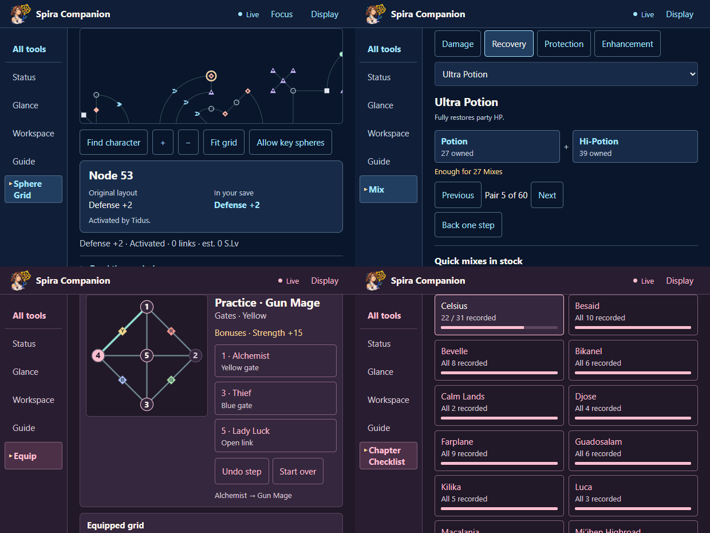

# Four ways to read the lower screen during play

The most specific piece of feedback came from a player looking at Strength and Magic nodes that shared a color. Another player wanted to move through Rikku’s Mix chart from either direction. Both describe a moment when the answer is already in the data and the interface makes it hard to see. Those two requests lead the ranking.

*Chrome replay using the Bevelle and Celsius captures. Each pane is 620 × 465. The Garment Grid image shows a practice move.*

## 1. Recognize a Sphere Grid node and inspect what changed

Players requested a symbol legend, original and current node contents, and a way to find activation spheres. Related discussions about Standard and Expert maps reinforce the value of working on the player’s own layout. Spira already had both layouts, route costs, character positions and a separate build sandbox. [Direct feature requests](https://www.reddit.com/r/finalfantasyx/comments/1uuiln4/ffx_companion_app_sphere_grid_request_for_features/) · [Standard and Expert layout discussion](https://www.reddit.com/r/finalfantasyx/comments/1x5mdeu/) · [Planner discussion](https://www.reddit.com/r/finalfantasyx/comments/1r49c6f/)

The map now opens around the selected character when their position is known. A diamond denotes a Power Sphere node, a triangle denotes Mana, and five further symbols cover the other node families. Select a node to see its original contents beside the live value and who has activated it. Eligible nodes list Master Sphere and any applicable ally-based remote sphere, with your stock and a link to item sources. The selected character’s zoom, position and search survive live updates. The map’s legend uses the same drawing code as its nodes. [Grid viewer](https://github.com/Grayfox96/FFX-Sphere-Grid-viewer) · [Sphere rules](https://jegged.com/Games/Final-Fantasy-X/Items/Spheres.html) · [W3C guidance on alternatives to color](https://www.w3.org/WAI/WCAG22/Understanding/use-of-color.html)

## 2. Follow a Mix from its effect to its ingredients and back

Players described using a companion for Mix while playing and directly requested a searchable chart they could traverse. A separate Mix release and a dedicated GitHub compendium both cover the full recipe table. The compendium links results, items and sources. A creator’s guide to favorite Mixes helped frame the initial choice around what the player wants Rikku to do. [Player feedback](https://www.reddit.com/r/finalfantasyx/comments/1xkkxmr/) · [Full-table discussion](https://www.reddit.com/r/finalfantasyx/comments/1rbzs65/) · [Mix Compendium](https://github.com/gitkwedl/FFX_Mix_Compendium) · [YouTube Mix guide](https://www.youtube.com/watch?v=XBsuc8euvaw)

Open **Explore Mix by effect** and choose damage, recovery, protection or enhancement. The explorer covers all 64 results and 6,328 unordered pairs. Each pair shows both ingredients and how many times Rikku could make it. Tap either item for its other results, choose one for compatible partners, or check the item’s sources and return to the same ingredient. When you page to a specific pair, a stock change updates its quantities while keeping that pair selected.

## 3. Try a spherechange and see the Garment Grid pay off

Players discussing FFX-2 disagreed about how often they switched dresspheres. Several described their difficulty understanding when a gate was worthwhile or why they would change jobs in battle. A rehearsal is our design response to that discussion. The earlier companion could already calculate a route and read crossed gates. [Garment Grid discussion](https://www.reddit.com/r/FinalFantasy/comments/q5vj4e/did_anyone_ever_use_the_garment_grids_in_ffx2/) · [Farplane’s X/X-2 tooling](https://github.com/topher-au/Farplane)

**Rehearse spherechanges** lets you tap a connected slot or choose the next dressphere by name. Each step reveals its gate and any combination bonus you have earned in practice. Undo walks the path back. The route and the live game keep their own state. On a supported battle reading, starting from the current slot includes gates already crossed. Reference layouts use slot numbers until the game supplies the dresspheres.

## 4. Pick the next FFX-2 destination from the chapter checklist

Players describe losing their place on a completion run, and other fans publish checklists for missables. This supports organizing by the next actionable visit. The exact board layout is our proposal. [Completion-run discussion](https://www.reddit.com/r/finalfantasyx2/comments/1w9waku/) · [Community checklist and feedback](https://www.reddit.com/r/FinalFantasy/comments/1x67gru/) · [YouTube checklist example](https://www.youtube.com/watch?v=af4QVy8O7fo)

The **Destination board** groups all 525 mapped PS2 USA scene flags across five chapters. Destinations with unrecorded flags appear first. Tap one to read the interaction and recovery instructions. Scenes watched through Shinra’s network lead to the Celsius and retain their viewing location in the details. The board has filters for unfinished destinations and conditional routes. Earlier unrecorded flags carry a recovery note. The separate manual checklist continues to store the player’s own marks.

## How the ranking was chosen

We compared specific player requests, independent examples of the same problem, related open-source tools, and what version 1.42 already did. The original FFXII Thor project provided the lower-screen comparison. Safekeeping supplied a second FFX companion reference. Video descriptions and chapter listings informed use cases. The sample supports a stronger claim about player demand for the first two features than for the exact designs in the last two. Votes, downloads and video views were not pooled into a popularity score. [Original Thor companion](https://github.com/Cybranfox/ffxii-thor-companion) · [Safekeeping for FFX](https://github.com/Safemode/Safekeeping-for-FFX) · [Previous lower-screen research](research-1.42.md)
