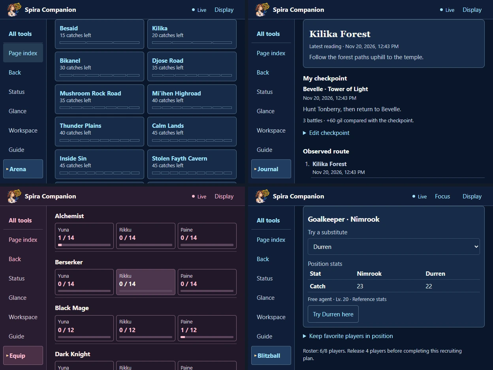

# What belongs on the Thor’s lower screen?

For an Arena run, the useful question is often “Which region can I finish tonight?” For a player returning after a month, it’s “What was I doing here?” We tried both on version 1.43, then opened every tool available in a recorded FFX International field session and an FFX-2 USA Chapter 5 session. That produced 57 game/tool combinations and 44 distinct tools. The priorities below combine recurring player problems, comparable tools, and what we could reproduce in Spira.

*Each pane is a 620 × 465 browser replay. The atlas and mastery board use Thor game readings. The journal uses an entered note and a controlled change of area, gil and battles. The goalkeeper comparison uses the planner’s level-20 scenario.*

## Ranked changes in 1.44

1. **Find the next Monster Arena region worth visiting.** Players independently asked how to track missing species and shared their own region checklists. That was the strongest recurring request. **Monster Arena → Capture atlas** shows all 13 regions. Pick one, five or ten captures per species. Unfinished regions nearest the chosen goal rise to the top. Each segment represents a species. Tap through for its name, exact count, hunting spots and the creations it contributes to. A missing reading appears as unknown. [Player tracking question](https://www.reddit.com/r/finalfantasyx/comments/1k2xfcn/) · [Second tracking question](https://www.reddit.com/r/finalfantasyx/comments/1d0nvn7/) · [Community regional checklist](https://www.reddit.com/r/finalfantasyx/comments/1us3xqz/) · [Independent checklist](https://github.com/ramuh553/FFX_MonsterArena_Checklist) · [Automatic checklist](https://github.com/ramuh553/Automatically-Updating-Monster-Arena-Checklist-for-FFX)
2. **Remember why you saved here.** Returning players asked where to go after a long break. Thor owners also described taking notes on the second screen. In either game, **Journal** now keeps a personal checkpoint, a dated note and the last 24 observed area changes. Open it after restarting Spira, even with the game closed. It shows the last place Spira saw and the battle and gil changes since the checkpoint. Loading an earlier story, chapter or battle count can trigger a warning. Two different saves with similar forward progress can still look alike. [Returning after two years](https://www.reddit.com/r/FinalFantasy/comments/1ld1w30/picking_back_up_after_2_years_where_do_i_go_ffx/) · [Another returning player](https://www.reddit.com/r/finalfantasyx/comments/1v79fb2/) · [Taking notes on Thor](https://www.reddit.com/r/AynThor/comments/1qvz1ag/taking_notes_and_screenshots/)
3. **Look something up and return to where you were reading.** The Pixel Guide community and another dual-screen companion’s requested return-to-guide behavior informed this change. **Page index** searches the open tool and links to related ones. **All tools** groups tools by task. **Back** restores your previous tool and reading position, including selected region or fiend filters on the main reference screens. In the supported offline FFX walkthrough, the index exposes 292 destinations and distinguishes repeated names. It works through **All tools** in the full-screen reader. [Pixel Guide release discussion](https://www.reddit.com/r/AynThor/comments/1t1siva/pixel_guide_new_version_out_v13/) · [Pixel Guide source](https://github.com/rexmont/Pixel-Guide-Android) · [Return-to-guide change in another companion](https://github.com/bhuiyah/ff7-recomp-android/releases/tag/v0.1.45)
4. **See who still needs a dressphere before spending AP.** Players asked how learning works and how to use jobs across the party. **Equipment → Party dressphere mastery** puts Yuna, Rikku and Paine beside each owned standard job. Tap a character to see their ability list or filter to unfinished jobs. The audit also uncovered a data error. Trainer and Mascot have character-specific commands, and Spira had shown Yuna’s lists for Rikku and Paine. The equipment detail, mastery board and training shortlist now use the right names and AP counters. [Learning skills discussion](https://www.reddit.com/r/FinalFantasy/comments/qyc6xu/) · [Dressphere discussion](https://www.reddit.com/r/finalfantasyx/comments/1gz6nzs/) · [AP farming video](https://www.youtube.com/watch?v=gRLXoxvg9Tk) · [Farplane’s job identities](https://github.com/topher-au/Farplane/blob/master/FFX2/Values/Dresspheres.cs) · [Square Enix manual](https://cdn.sqexeu.com/sea/ffxii/manuals/FFX-FFX2_PS3_ManInt_English_013014.pdf)
5. **Try a Blitzball signing and see what that position gains.** Players publish team ratings and ask who to recruit. Spira already suggested a lineup. **Blitzball → Team Builder → Compare options** now puts two players’ position-relevant stats side by side. Try the substitute at any of the six positions and release the slot back to the planner. Contract availability and reference level accompany the comparison. The lineup is a planning scenario. [Player-built team ratings](https://www.reddit.com/r/finalfantasyx/comments/1vnlf0e/blitzball_overall_ratings_and_automatic_team/) · [Recruiting discussion](https://www.reddit.com/r/finalfantasyx/comments/1w3fmct/) · [Blitzball comparison app](https://github.com/theadamantium/BlitzballAppv2) · [Player locations and team guide on YouTube](https://www.youtube.com/watch?v=4AuHe4q_41E)
6. **Find a fiend without scrolling through the entire game.** At 620 × 465, the previous FFX Bestiary measured 40,773 pixels of scrolling content. FFX-2 measured 42,307. The same two readings now measure 2,146 and 2,356 pixels. Both tools search the full catalog first and present 12 matching entries per page, with named ranges and previous/next controls. FFX capture dossiers put the hunt and creation links beside the fiend’s item information. This priority came from measuring Spira directly and comparing lookup tools. [FFX Lookup Tool](https://github.com/andreasSchauer/ffx-lookup-tool/) · [Safekeeping for FFX](https://github.com/Safemode/Safekeeping-for-FFX)
7. **Tell a controller-focus issue apart from a lost emulator connection.** Thor owners reported that opening a lower-screen app could move controller focus. **Setup → The controller is on the wrong screen** now explains how to check the active display and test game input while leaving the PINE connection alone. This is diagnostic help. System control routing depends on the device configuration. [Two-user issue report](https://github.com/RobZombie9043/es-de-companion/issues/104) · [Thor starter guide on YouTube](https://www.youtube.com/watch?v=lNfo6MkyPpk)

The ranking reflects how directly people described each problem, how often it appeared across the sampled discussions and the friction we saw on the lower screen. Reddit discussions supply the player requests. GitHub projects show existing approaches. YouTube descriptions and chapter listings helped identify playing and setup workflows. The exact layouts, rankings and visual choices are our design decisions. The original dual-screen project and an FFX-2 save editor provided additional comparisons. [FFXII Thor Companion](https://github.com/Cybranfox/ffxii-thor-companion) · [FFX-2 Save Editor](https://github.com/Meth962/FFX2SaveEditor)

## Section-by-section audit

Each row gives the first action or decision we prioritized for that section. The new tools and data corrections are described above. Existing tools gained a searchable page index with relevant destinations and shortcuts tailored to the current game and available controls.

| Section | First priority on the lower screen |
| --- | --- |
| Monster Arena | Pick a region by remaining catches, then open the exact species in its dossier or hunt. |
| Journal | Read the last checkpoint before editing it. Check the observed route and party objective. |
| Guide | Search the imported walkthrough by section name and jump there while browsing. |
| Status | Jump to the field map, walkthrough, front line or chapter review as the current reading allows. |
| Glance | Open the index from the full-screen view. Exit Glance returns to the previous tool. |
| Map | Find player follow, exits or the previous area and reach game-appropriate journey tools. |
| Workspace | Reach pins, playthrough notes and global search without paging through every section. |
| Equipment | In X-2, compare three characters’ mastery and go directly to an AP record. In X, find gear comparison and customization. |
| Party | Reach formation and progress with related equipment and training tools nearby. |
| Items | Find the inventory and farming ledger. Related tools lead to equipment or Mix where available. |
| Rikku’s Mix | Jump to the effect explorer, pinned recipes or the pair checker. Find ingredient reserves alongside them. |
| Sphere Grid | Find a node or its symbol legend. Return from another tool to the selected character and node. |
| Grid sandbox | Find saved builds or focus the control that copies the current grid for planning. |
| Goal planner | Reach goal and party selection, the next step and additional item targets. |
| Boss Prep | Find a fight and party material needs. Reach the hit planner or story coach from the same index. |
| Battle comparison | Reach the target and available comparisons in battle. Related preparation tools also work in the field. |
| Bestiary (FFX) | Search all fiends or ingredients, move by named range and follow an Arena dossier to a hunt or creation. |
| Bestiary (FFX-2) | Search all mapped forms and filter by area before paging. Follow through to Oversouls or Via Infinito. |
| Fiend Guide | Find Oversoul tracking and Gun Mage tools, then review a fiend in Bestiary. |
| Missables | Find Anima temple treasures and related Cloister steps, collections and walkthrough. |
| Collections | Reach collection selection and the missing-only filter. Back restores the chosen collection. |
| Blitzball | Choose a position and compare a named substitute. Reach rewards and live match details from the index. |
| Challenges | Find the current game’s minigame records and individual guides, including Remiem or the Thunder Plains. |
| Cloister guide | Reach the temple selector or open the walkthrough. The field map and missables list sit alongside it. |
| Chapter Checklist | Jump to destination progress, missing-scene diagnosis or chapter selection. Reach the itinerary and save comparison. |
| Story boss coach | Focus the fight and battle-stage choices, with a route back to Boss Prep. |
| Remiem race navigator | Find the prize selector or focus the control for returning the practice route to its start. |
| Thunder Plains wall solver | Find the cave clear, wall number and checkpoint totals. |
| Boss hit planner | Focus the opponent, hit goal or Aim stacks, then return to preparation. |
| Mascot episode board | Find the region filter and search by the place whose episode outcome you need. |
| Celestial weapon power | Jump to the weapon owner and return to Equipment for that character’s gear. |
| Besaid cipher notebook | Find the relevant door or digit field while entering clues. |
| Capture circuit | Reach the captures-per-species target or a hunting-area inspection. Open the atlas through Monster Arena. |
| Chapter itinerary | Find the chapter and story branch before working through the next destination. |
| Customization shopping list | Find the auto-ability or desired quantity, then return to Equipment. |
| Bribe shopping comparison | Find the target item and a candidate fiend. Return to the previous Bestiary search. |
| Mix ingredient reserves | Search for the ingredient to keep or the desired Mix. |
| Compare chapter saves | Find the bookmark control. Recording a bookmark still takes an explicit press in the tool. |
| Gun Mage party board | Find the ability list, then open the relevant character’s entry. |
| Via Infinito floor sweep | Find the floor range and the associated fiends, then open their Bestiary entries. |
| Next AP abilities | Find the training shortlist and open a character’s actual job list, including Trainer and Mascot variants. |
| Farming ledger | Focus the start-comparison control before a farming session. The index leaves the baseline intact. |
| Profiles | Find the current playthrough and backup controls. The journal follows the active profile. |
| Setup | Separate controller focus from connectivity and find gameplay preferences. |
| Cheats (optional) | Appears when enabled in Setup. Index results focus edit controls. Preview, confirmation and application stay in the tool. |
| Display (global settings) | Keep palette and text controls available through All tools in the full-screen walkthrough. |

## Verification

The Bevelle and Celsius sessions were replayed through the companion’s normal update and navigation paths. We exercised the 44 ordinary tools at 350 × 420, 620 × 465 and 900 × 675 with the default and 200% text settings. Interaction checks covered atlas → fiend → hunting spots and Back, a journal restart and older-save warning, role substitutions, both pagers, AP drill-down and the supplied offline guide. Character-specific AP costs and counters were cross-checked against the PS2 USA tables. The public package contains the reference records. Players supply their own games and imported guide. [Test and release details](../THOR-VALIDATION.md) · [Player instructions](player-guide.md)
