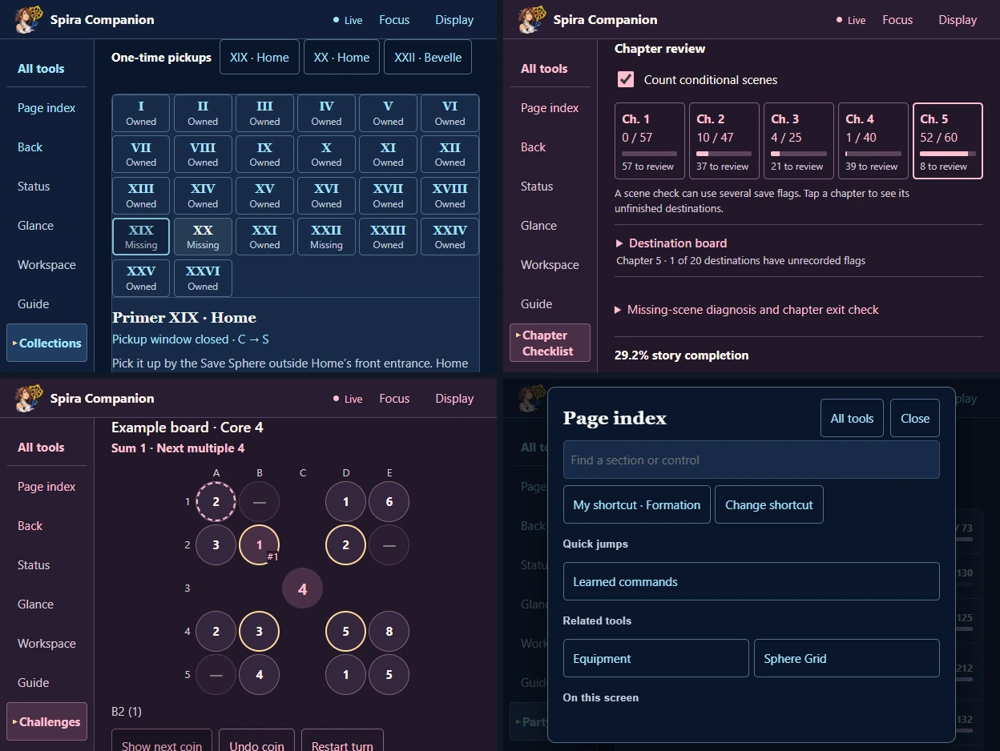

# Finding the missing scene, primer or page

A player described searching a walkthrough, finding the answer, and then losing the page they had been reading. An FFX-2 player could get an answer from a Sphere Break calculator but couldn’t tell which coin it meant. Those are good tests for a handheld companion. The lower screen has to show what to do with an answer while the game is still running above it. [Walkthrough feedback](https://www.reddit.com/r/AynThor/comments/1ps2ifa/) · [Sphere Break calculator feedback](https://www.reddit.com/r/ffx/comments/s3y0if/)

*Four 620 × 465 browser views. Chapter review uses a recorded FFX-2 USA Chapter 5 save. The primer example removes three ownership bits from a recorded FFX frame to show the missing-volume workflow. The practice board and shortcut are player inputs.*

## Ranked improvements

| Rank | Player problem and evidence | What shipped |
| --- | --- | --- |
| **1. Audit a completion run across all five chapters** | Players ask which part of a run cost them a fraction of a percent. A community save viewer and a chapter-by-chapter walkthrough tackle the same problem from different directions. [Percentage breakdown discussion](https://www.reddit.com/r/finalfantasyx/comments/1j57zhw/) · [Completion-run discussion](https://www.reddit.com/r/finalfantasyx2/comments/1w9waku/) · [Community guide and save viewer](https://ffx2.gdc.ia.br/guia/) · [Chapter 1 video guide](https://www.youtube.com/watch?v=acXFvIOgSLY) | **Chapter Checklist → Chapter review** shows recorded scene checks for all five chapters together. Include conditional scenes when reviewing a branch. Tap a chapter to open its unfinished destinations, then inspect the scene and recovery instructions. A scene check can group several flags. The game’s story percentage remains a separate reading. |
| **2. Find and use the missing Al Bhed Primers** | Players repeatedly ask which volumes can be missed at Home or Bevelle. Some also try to decode dialogue with just the letters they’ve learned. [Missed Home volumes](https://www.reddit.com/r/finalfantasyx/comments/kr9ric/) · [Which volumes are missable?](https://www.reddit.com/r/finalfantasyx/comments/1i5mcc8/) · [Deciphering with one primer](https://www.reddit.com/r/finalfantasyx/comments/1m7mio9/) · [Location guide](https://jegged.com/Games/Final-Fantasy-X/Side-Quests/Al-Bhed-Primer-Locations.html) · [All 26 on video](https://www.youtube.com/watch?v=xidZmamFpz8) | **Collections → Al Bhed Primers** puts all 26 Roman numerals on a shelf. Each volume says Owned or Missing. The four one-time books get shortcuts when missing. Selecting one shows the area, pickup instructions and letter pair. **Read an Al Bhed phrase** decodes English-language Al Bhed using your save, or the full alphabet if you choose. [Independent alphabet implementation](https://github.com/carolcurcelli/albhed) |
| **3. Learn Sphere Break by playing one untimed turn** | Multiple players describe struggling against Shinra. Solvers and creator guides already explain the math. The specific gap was connecting a result to positions on the board. [Player reports](https://www.reddit.com/r/finalfantasyx/comments/1tchogi/sphere_break_is_breaking_me/) · [Shinra discussion](https://www.reddit.com/r/FinalFantasy/comments/1iajxme/) · [Independent solver](https://github.com/mbinette91/ffx2-sphere-break) · [Shinra video](https://www.youtube.com/watch?v=g4N199waa90) | **Challenges → Sphere Break → Practice Sphere Break** lets you tap actual positions on an untimed board. Start with an entry coin, watch the running sum, follow a suggested coin or try your own sequence. The first multiple ends the turn. Undo a pick or practice the board you entered into Spira’s calculator. The game receives no inputs. |
| **4. Bookmark a room or boss in the offline FFX walkthrough** | A Thor owner specifically asked for multiple bookmarks because a text search displaced their last reading position. Comparing the actual imported guide with Spira’s index exposed a second gap. Many rooms, maps and bosses had headings with no link in the table of contents. [Direct request and author response](https://www.reddit.com/r/AynThor/comments/1ps2ifa/) · [Pixel Guide](https://github.com/rexmont/Pixel-Guide-Android) | **Guide → Bookmarks → Save current section** works in the docked and full-screen reader. Open a bookmark to browse that section, then use **Back to game** to resume following. The compatible export now has **991 indexed destinations**, up from 292. Besaid Temple is an example that became independently searchable. Bookmarks survive an app restart within the active profile. |
| **5. Open a tool at full width and keep navigating** | Handheld owners describe trying to consult the lower screen while keeping control of the game. The original FFXII companion and Retro Game Corps’ dual-screen guide provided the device comparison. This layout addresses the space and navigation costs we measured inside Spira. System-level controller focus remains a device setting. [Thor discussion](https://www.reddit.com/r/AynThor/comments/1um1an3/) · [FFXII Thor Companion](https://github.com/Cybranfox/ffxii-thor-companion) · [Retro Game Corps guide](https://retrogamecorps.com/2025/10/27/dual-screen-android-handheld-guide/) | **Focus** now works across ordinary tool pages. Page index stays reachable, with **All tools** inside it. **Display → When opening a tool → Use full width** carries the layout between tools. On a 620-pixel viewport, Party’s content area grew from about **502 to 620 pixels**. Guide and Glance retain their dedicated full-screen modes. |
| **6. Put one frequently used control at the top of each tool’s index** | Tool pins already opened entire tools. They could take a player back to Equipment, for example, but still left them searching for the same part of Equipment. A per-tool shortcut is our design response to the repeated place-finding problem. [Player feedback](https://www.reddit.com/r/AynThor/comments/1ps2ifa/) · [Safekeeping for FFX](https://github.com/Safemode/Safekeeping-for-FFX) | Open **Page index → Set a shortcut**, search for the heading or control, and select it. Later, choose that saved shortcut to focus the control or reopen its disclosure. It cannot submit a form or apply a gameplay edit. The shortcut belongs to that game, tool and profile. It appears unavailable if the current view no longer contains its target. |

We ranked recurring, specific player problems ahead of interface choices inferred from them. We compared the 1.44 build with handheld readers, FFX trackers, a Sphere Break solver, an Al Bhed translator and FFX-2 save tools. Video titles, descriptions and chapter listings supplied examples of how creators teach these tasks. Votes, views, and download counts measure different things and were not combined. These sources are a sample of related projects and discussions. [FFX-2 Save Editor](https://github.com/Meth962/FFX2SaveEditor) · [Published 1.44 baseline](research-1.44.md)

## Priorities by section

The first column names the actual tool. The second gives the first task to optimize and the specific new feature or shortcut to try there. Shortcut availability follows the controls and game data currently on screen. A desktop-width table, a live encounter and an empty field reading can expose different targets.

| Section | First priority and implementation |
| --- | --- |
| Status | Keep battle or journey advice in view. Use Focus, then save a jump to Front line during a field reading. |
| Glance | Keep the party visible in its dedicated view. Use Index to save a jump to the field objective or front line. |
| Guide | Bookmark a specific room, boss or map. Search the expanded index, browse the bookmark, and resume game following. |
| Map | Give exits and the player marker the full width. Use the focused index to return to player-follow controls. |
| Journal | Keep the checkpoint note and route easy to revisit. Save My checkpoint as the return target. |
| Workspace | Reach pinned tools or notes directly when the lower screen is full. |
| Party | Give formation and character rows more space. Save Formation to jump back after checking equipment. |
| Items | Go straight to inventory search or the farming ledger shortcut. |
| Equipment | Favor the part you use for this game, such as gear comparison in X or party dressphere mastery in X-2. |
| Rikku’s Mix | Save the effect explorer or pair checker and open the full-width ingredient table. |
| Sphere Grid | Keep the diagram wide and use a personal jump to the node search or legend. |
| Grid sandbox | Put Saved builds or Copy current grid in the index. The latter focuses the control before you choose to copy. |
| Goal planner | Choose a shortcut to goal selection or additional item targets. Shared material lists can use the full width. |
| Boss Prep | Keep your party’s material deficits accessible from the focused page index. |
| Battle comparison | Read the target and action estimates at wider width. A saved encounter-only target waits for a matching view. |
| Monster Arena | Go straight to the capture or creation control you use between hunts. |
| Bestiary (FFX) | Pin a shortcut to fiend or item-source search. The results stay usable in the wider layout. |
| Bestiary (FFX-2) | Favor encounter-area filtering or the fiend page selector. |
| Fiend Guide | Return directly to Oversoul tracking or the Gun Mage controls. |
| Missables | Read the full pickup instructions. Choose the Anima temple treasure control when checking seals. |
| Collections | Inspect all 26 primer volumes, one-time pickups and the cipher from the same collection. |
| Blitzball | Reach Team Builder or the live match controls while leaving more room for the position comparison. |
| Challenges | Practice a Sphere Break turn in X-2. In X, set a shortcut to the challenge selector or a preferred race. |
| Cloister guide | Read puzzle directions beside the wider diagram and keep temple selection within one index jump. |
| Chapter Checklist | Compare five chapters and open the unfinished destinations of the one you choose. |
| Story boss coach | Keep the fight or stage selector in the focused page index. |
| Remiem race navigator | Return to the prize choice or a route control while keeping room for the course diagram. |
| Thunder Plains wall solver | Jump to the wall or checkpoint input. A shortcut never enters a code. |
| Boss hit planner | Keep opponent or Aim stacks close while comparing party forecasts. |
| Mascot episode board | Choose the region filter or the outcome you are currently reviewing. |
| Celestial weapon power | Jump to weapon owner and read its current HP or MP effect at full width. |
| Besaid cipher notebook | Favor the current door or a digit field. Shortcut selection leaves the code intact. |
| Capture circuit | Put the capture target or area inspection first during a hunt. |
| Chapter itinerary | Keep chapter or branch selection within reach between visits. |
| Customization shopping list | Jump to the auto-ability or quantity field while planning multiple pieces. |
| Bribe shopping comparison | Go directly to your target item and use the wider fiend comparison. |
| Mix ingredient reserves | Favor the ingredient-to-keep control before comparing recipes. |
| Compare chapter saves | Jump to the bookmark control. Recording a save comparison still requires its own press. |
| Gun Mage party board | Reach the ability filter and compare the three characters on the wider screen. |
| Via Infinito floor sweep | Choose a floor-range control or a listed fiend when reading a sweep. |
| Next AP abilities | Jump to the training shortlist or a job that is currently available. |
| Farming ledger | Focus the baseline control while preserving the comparison until you explicitly start one. |
| Profiles | Reach playthrough selection or backup. Each profile keeps its own reader bookmarks and tool shortcuts. |
| Setup | Reach controller-focus help or gameplay options directly. |
| Cheats (optional) | When enabled, its index can focus a control. Applying a change still requires the tool’s review and confirmation. |
| Display (global) | Choose full width as the default across tools, or enter and exit Focus for one visit. |

[Player instructions](player-guide.md) · [Verification and supported builds](../THOR-VALIDATION.md)
